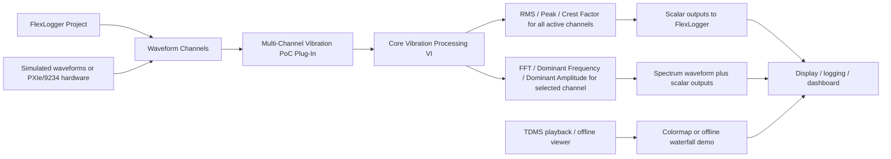

# Simplified architecture

## Objective

Create one FlexLogger calculation plug-in that accepts multiple waveform channels, computes vibration metrics, and returns scalar and waveform outputs to FlexLogger.

## High-level architecture

## Key boundaries

- FlexLogger owns acquisition configuration and data delivery.
- The plug-in owns calculation logic and output mapping.
- A separate LabVIEW utility or offline VI can demonstrate the colormap or waterfall view.
- This is intentionally limited to a PoC and not a full NVH platform.

## Processing flow

1. Initialize plug-in configuration.
2. Read active waveform inputs and channel metadata.
3. Validate all waveforms for size, rate, NaN, and empty states.
4. Compute RMS, peak, and crest factor for all configured active channels.
5. Compute FFT and dominant metrics only for the selected FFT channel.
6. Return calculated scalar outputs and a spectrum waveform.
7. Report status and diagnostics.
8. Cleanup on shutdown.

## Recommended decomposition

- Vibration-Core/
  - Shared signal validation
  - RMS, peak, crest factor
  - FFT and dominant-frequency logic
  - Unit and configuration handling
- FlexLogger-Plugin/
  - PDK lifecycle wrappers
  - FlexLogger channel map
  - Output channel creation
  - Error reporting
- Colormap-Demo/
  - Offline spectrum viewer / waterfall display

## Design decisions

- [NOT REQUIRED FOR POC] Live FFT for all 32 channels
- [DECISION REQUIRED] Exact FlexLogger output type for the selected FFT waveform
- [HARDWARE CHECK REQUIRED] Which hardware modules will be used for final system validation
- [COMPATIBILITY CHECK REQUIRED] Which FlexLogger and LabVIEW versions are installed on the target machine

## PoC scope

This architecture supports the minimum target of 32 configurable waveform inputs and a single detailed FFT channel. It is intentionally smaller than a production NVH framework.
