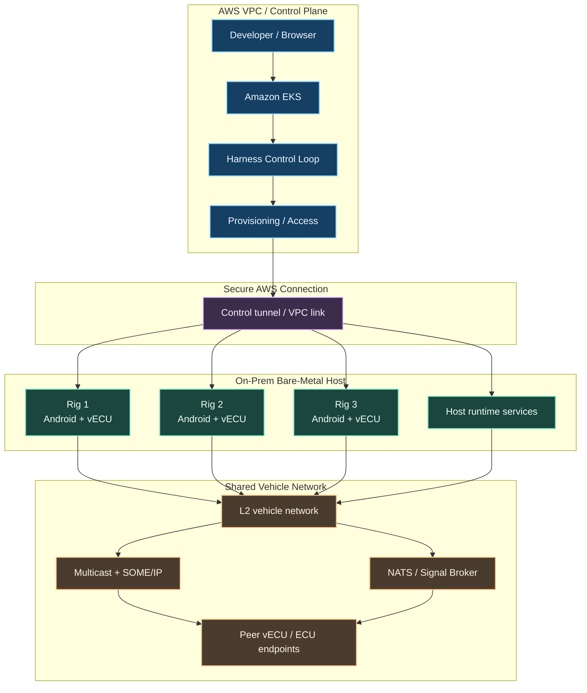
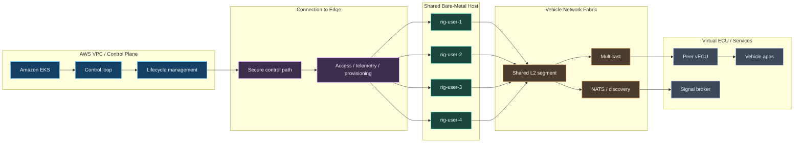

```mermaid
sequenceDiagram
    participant Dev as Developer
    participant AWS as AWS Control Plane
    participant Link as Secure Cloud Link
    participant Host as Bare-Metal Host
    participant Rig as Rig Instance
    participant Net as Shared Vehicle Network
    participant Broker as NATS / Broker

    Dev->>AWS: Start / access environment
    AWS->>Link: Provision and manage rig
    Link->>Host: Connect control path
    Host->>Rig: Launch Android + vECU stack
    Rig->>Net: Join shared L2 fabric
    Rig->>Broker: Register service / signal endpoint
    Dev->>Host: Access UI, logs, adb
    Rig-->>Net: Publish / subscribe traffic
    Net-->>Broker: Route vehicle messages
    AWS->>Host: Scale / tear down
```
