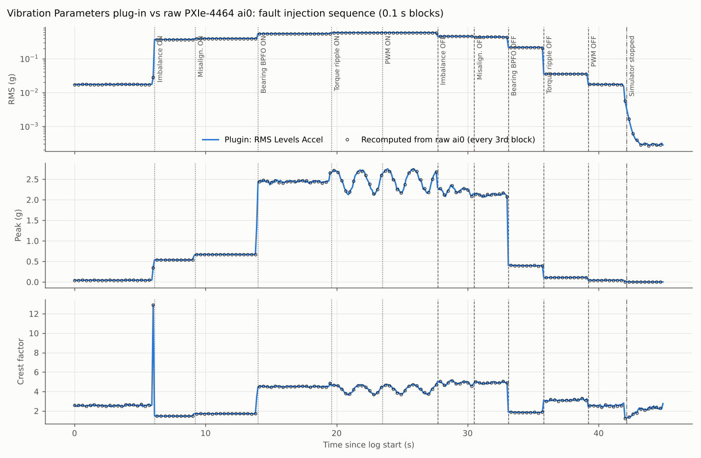

# Validation report: Vibration Parameters plug-in on a real PXIe-4464 channel

| | |
|---|---|
| **Date** | 2026-11-18 |
| **Stage** | Hardware validation of the single-channel plug-in (one instance per axis) |
| **Result** | **PASS**. Plug-in outputs match the raw 4464 data to machine precision; ai0 tracks every injected fault |
| **Data file** | `MyTest_2026-11-18-18-30-44.tdms` (FlexLogger 2026 Q3, 45 s) |
| **Figure** | `2026-11-18_pxie4464-validation.png` (this folder) |

## 1. What was validated

Earlier stages used simulated data inside LabVIEW (`tests/unit-tests/power-spectrum-test.vi`). This stage validates the plug-in **inside FlexLogger, reading a real PXIe-4464 analog input**. The calculation input is now a live hardware acquisition, not a simulated waveform.

The stimulus is the eDyno NVH accelerometer simulator (`eDyno NVH Accel Simulator.vi`), generated on a PXIe-4468 AO channel and wired to PXIe-4464 ai0. It produces a known accelerometer signal with switchable faults.

Two questions were checked:
1. **Do the plug-in's outputs equal the parameters computed from the raw ai0 samples?**
2. **Does ai0 contain the faults the simulator is injecting, at the expected frequencies and amplitudes?**

## 2. Setup

| Item | Setting |
|---|---|
| Acquisition | PXIe-4464 `DSA_4464/ai0`, 51.2 kS/s, accelerometer channel in g, sensitivity 100 mV/g |
| Stimulus | PXIe-4468 `ao0`, 51.2 kS/s, 100 mV/g, constant speed 3000 rpm (1× = 50 Hz), 4 pole pairs |
| Plug-in | `Vibration Parameters`, **one input channel per instance**, outputs: Power in Band, Crest Factor, Peak, RMS, Max, Min, Max-Min |
| Plug-in timing | Set Plugin Resampling = **No Resampling**, Block Size = **0.1 s**; Set Plugin Timing removed |
| Output channels | Wfm (DBL), Produced by Plugin; Write 1D Wfm (DBL) with **Auto Calculate T0 = TRUE** |
| Calculation | `PowerSpectrum.vi`: one result per block, output t0 = block start, dt = block length, restart averaging = TRUE, Hanning window |
| Simulator baseline | 1× 0.02 g peak, noise floor 0.01 g RMS |

## 3. Procedure

1. Start the simulator at the baseline and start logging in FlexLogger.
2. Turn faults on one at a time, top to bottom: Imbalance (0.5 g @ 1×), Misalignment (0.2 g @ 2×), Bearing BPFO (2 g impacts, BPFO = 3.57× = 178.5 Hz, 3.5 kHz resonance), Torque ripple (0.3 g @ 1200 Hz), PWM noise (0.05 g @ 16 kHz).
3. Turn them off in the same order, starting from the top.
4. Stop the simulator, then stop logging.
5. Offline: recompute every plug-in parameter from the raw ai0 samples block by block, and check ai0's spectrum and envelope against the simulator settings.

Fault switching times, detected from the ai0 data:

| Fault | ON (s) | OFF (s) |
|---|---|---|
| Imbalance | 6.1 | 27.7 |
| Misalignment | 9.2 | 30.5 |
| Bearing BPFO | 14.0 | 33.1 |
| Torque ripple | 19.6 | 35.8 |
| PWM noise | 23.5 | 39.2 |
| Simulator stopped | 42.1 | |

## 4. Results

### 4.1 Timing

| Check | Result | |
|---|---|---|
| Output block length | Constant **5,121 samples** (dt = 0.100020 s) for all 450 blocks | ✓ |
| Coverage | 450 × 5,121 + 1 = **2,304,451 samples = ai0 length exactly** | ✓ |
| Start offset | Plug-in t0 = ai0 t0 + 1 sample (20 µs) | ✓ (negligible) |
| Alignment in DIAdem | Plug-in channels span the same 45 s as ai0; no alignment script needed | ✓ |

FlexLogger delivered fixed-size blocks, so the simple design (read → calculate → write, one result per call) is sufficient. The buffering design (`Vibration Block Processor.vi`) is **not needed** for this configuration.

### 4.2 Plug-in outputs vs raw ai0 (all 450 blocks)

| Parameter | Max relative difference | |
|---|---|---|
| RMS | 8e-16 | ✓ |
| Max, Min, Peak, Max-Min | 0 | ✓ |
| Crest Factor | 9e-16 | ✓ |
| Power in Band vs RMS² | ratio 0.97–1.04 in steady blocks | ✓ |

Power in Band departs from RMS² (0.39 and 1.25 at the extremes) only in blocks where a fault switched mid-block. This is expected: Power in Band comes from a Hanning-windowed spectrum, which weights the block centre, while RMS weights all samples equally. For the same reason, the Crest Factor spike of 12.9 at 6.1 s is a single block that straddles the Imbalance step.

### 4.3 ai0 vs the injected signal

| Time (s) | Event | Measured on ai0 | Expected | |
|---|---|---|---|---|
| 0–6 | Baseline | 1× 0.020 g, RMS **0.0172 g**, crest 2.55 | √(0.02²/2 + 0.01²) = 0.0173 g | ✓ |
| 6.1 | Imbalance ON | 1× **0.515 g**, RMS 0.364 g, crest 1.47 | RMS 0.364 g; crest of a sine ≈ 1.41 | ✓ |
| 9.2 | Misalignment ON | 2× (100 Hz) **0.199 g**, RMS 0.390 g | RMS 0.390 g | ✓ |
| 14.0 | Bearing BPFO ON | Crest **1.7 → 4.5**, Peak **0.67 → 2.47 g**, energy in the 2.5–4.5 kHz band, **178.5 Hz line in the envelope spectrum** (0.355), almost none in the raw spectrum | Textbook rolling-element bearing signature | ✓ |
| 19.6 | Torque ripple ON | **0.299 g @ 1200 Hz**, RMS 0.582 g | √(0.542² + 0.299²/2) = 0.582 g | ✓ |
| 23.5 | PWM ON | 0.025 g each at **15.6, 16.0 and 16.4 kHz** | Carrier plus sidebands at ± 2 × electrical (± 400 Hz) | ✓ (see note) |
| 27.7 | Imbalance OFF | 1× back to 0.020 g | | ✓ |
| 30.5 | Misalignment OFF | 2× → 0 | | ✓ |
| 33.1 | Bearing OFF | Crest **4.9 → 1.9**, envelope line → 0 | | ✓ |
| 35.8 | Torque ripple OFF | 1200 Hz → 0, RMS 0.035 g (baseline + PWM) | | ✓ |
| 39.2 | PWM OFF | RMS back to **0.0172 g** | Same as baseline | ✓ |
| 42.1 | Simulator stopped | RMS 0.0003 g (4464 noise floor) | | ✓ |

**PWM note:** the simulator's 0.05 g PWM level appears as three lines of 0.025 g (carrier plus two sidebands). Spectral limits must decide whether 0.05 g means carrier amplitude or total PWM content.

## 5. Changes made to reach this stage

| Area | Change |
|---|---|
| `PowerSpectrum.vi` | Removed the For Loop (N = 9) that repeated each result 9 times. One result per block, **dt = block length** (was the input dt, 19.53 µs), t0 = block start, restart averaging = TRUE |
| Plug-in topology | 3-axis plug-in → **single-channel plug-in, one instance per axis**; added an `Axis` enum parameter; generic `Accel` suffix on output names |
| `Initialize.vi` | No Resampling + Block Size; Set Plugin Timing (Periodic 100 ms) removed |
| `Process.vi` | Read → Index Array 0 → calculate → Write 1D Wfm (DBL) with Auto Calculate T0 = TRUE |
| `tests/unit-tests/acc-daq-test.vi` | Wired accelerometer sensitivity = 100 mV/g (the unwired DAQmx default of 1000 mV/g read 10× low) |

## 6. Open items

| # | Item | Impact |
|---|---|---|
| 1 | Plug-in output channels have **no unit** in the TDMS. Set Unit = `g` (RMS, Peak, Max, Min, Max-Min) and `g²` (Power in Band) on Create Channel | Cosmetic, DIAdem labels |
| 2 | The **Window** parameter has no effect (the calculation always uses Hanning) | Misleading UI; remove it or wire it through |
| 3 | `PowerSpectrum.vi` is **not reentrant**. Set it to preallocated-clone reentrant before running several instances (X, Y, Z) | Throughput with several instances |
| 4 | Only **0.1 s** blocks were tested. 0.25 s is the recommended block for constant-speed NVH trending (more cycles of 1× per block) | Re-run at the chosen block size |
| 5 | Run-ups (500 → 4500 rpm) were not tested. Fixed time blocks smear frequencies during a run-up; use order tracking (Sound and Vibration) for that case | Scope |
| 6 | Only one channel (ai0) was validated. A multi-instance run (3 axes) and the 30-channel target in the PoC scope are still to be done | Scope |
